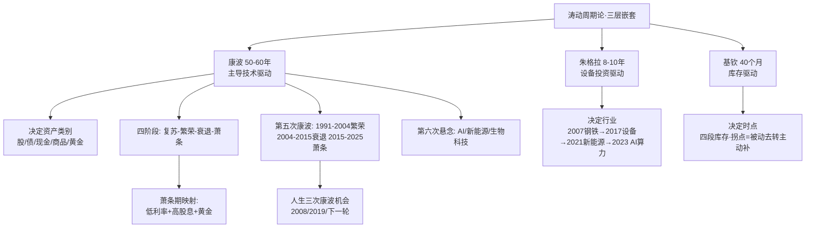

## 📋 文章信息

- **来源**: 知乎问答 - 「如何评价周金涛《涛动周期论》？」下的回答
- **作者**: 萌半仙
- **发布时间**: 2026年10月7日（编辑于 2026-10-07 12:11）
- **阅读链接**: https://www.zhihu.com/question/268372774/answer/2091125728674838434

---

## 🎯 核心摘要

这篇回答系统梳理了已故中信建投首席经济学家周金涛的周期研究框架：人生财富九成由周期位置决定，个人努力只决定下限。框架的核心是三层嵌套周期——50-60 年的康波决定资产类别、8-10 年的朱格拉周期（设备投资）决定行业、40 个月的基钦周期（库存）决定买卖时点，三层共振才有大牛市。作者用该框架复盘了 2005-2007、2014-2015、2019-2021 三轮行情，并延伸到大宗商品（产能出清）、黄金（实际利率）、高股息（萧条期低利率）的配置逻辑，最后落到当下：利率仍在历史低位，而 AI 是否构成第六次康波主导技术，是新旧周期交界处最大的悬念。

## 📊 核心观点

### 1. 人生发财靠康波——财富的九成来自周期位置

**背景/现状**：
- 周金涛依据康波理论给出人生机会窗口：康波 60 年一轮，有效工作年限约 40 年，一人一辈子约碰上三次康波机会。

**核心论述**：
- 40 岁以上的人第一次机会在 2008 年（金融危机砸出的资产低价），第二次在 2019 年；85 后的第一次机会在 2019 年。
- 对照案例：2015 年 5178 点满仓加两融的人与 2018 年底 2440 点定投指数的人，智商和勤奋可以互换，命运差异全在入场位置——"努力决定下限，位置决定上限"。

### 2. 三层嵌套周期模型——大周期给方向，中周期给行业，小周期给时点

**背景/现状**：
- 模型源自熊彼特，周金涛将其与中国资产价格实践结合。

**核心论述**：
- 康波（50-60 年）：由主导技术驱动，决定钱放在哪类资产——繁荣期股票为王，衰退期现金为王，萧条期债券黄金为王，回升期商品为王。
- 朱格拉周期（8-10 年）：驱动是设备投资/资本开支，决定钱放在哪个行业——2007 钢铁化工、2017 设备更新、2021 新能源、2023 至今 AI 算力。
- 基钦周期（40 个月）：驱动是库存，决定钱的进入时点；库存四段中"被动去库存转主动补库存"的拐点是上游资源股弹性最大的一段。
- 三层方向一致是大牛市（2005-2007，998→6124 点）；三层矛盾是结构市或杠杆牛（2014-2015 涨到 5178 只用一年，跌回只用几个月）。

### 3. 康波阶段论与第五次康波的划分

**背景/现状**：
- 康德拉季耶夫 1925 年发现 50-60 年长波，熊彼特补上技术解释：蒸汽纺织、钢铁铁路、电气化工、汽车电子、信息技术五轮。

**核心论述**：
- 周金涛的第五次康波划分：1991 年前后信息技术启动，繁荣期至 2004 年，2004-2015 衰退（冲击落在 2008），2015-2025 萧条。
- 萧条期的标准特征：利率趴地板、通缩压力反复、政府只能放水——全球负利率债券一度膨胀到十几万亿美元。
- 他在 2015 年推测下一轮康波主导技术大概率出在人工智能、新能源、生物科技——十年后资本市场最贵的正是 AI 资产。

### 4. 商品十年一机会——价格把产能熬死之后才是买点

**背景/现状**：
- 商品供给弹性差：矿山冶炼厂从立项到投产五年以上，需求下滑时价格先跌，真正底部要等产能大规模出清。

**核心论述**：
- 商品价格拆两层：需求跟库存周期（几年一来回），产能跟资本开支周期（一轮十几年）。
- 2011 年商品见顶跌四年后，2015 年底全球高成本产能清退七七八八，叠加 2016 年国内供给侧改革与库存回升同季出现，大宗商品集体见底——"价格下跌本身算不上机会，产能出清完了才是机会"。

### 5. 萧条期的资产映射——黄金看实际利率，高股息看低利率

**背景/现状**：
- 2016 年他在金价 1100 美元时喊黄金，五年后站上 2000 美元；2026 年中国 10 年期国债收益率 1.68%。

**核心论述**：
- 黄金双驱动：萧条期信用货币体系信誉下滑 + 实际利率走低；操作上只看一个指标——美国实际利率（国债收益率-通胀预期），往下走是买点。
- 萧条期实体经济回报率下降，股息率 4% 以上的资产对保险社保等长久期资金是稀缺品——这是近两年红利资产上涨的底层逻辑。

## 🧠 概念图谱

## 🔑 关键洞察

### 1. 层级错配是大多数亏损的来源

**分析**：
- 2015 年把库存弱回升当成康波新周期加杠杆冲进 5178 点，2021 年把短期缺货当长期逻辑追高新能源——两次大亏都是"把小周期读成大拐点"；反之在真拐点前被小波动吓退同样致命。框架的实用价值不在预测，而在给每次决策标注"我赚的是哪一层的钱"。

### 2. 产能出清是可验证的领先判据

**分析**：
- 相比"跌多了就是机会"的模糊直觉，"高成本产能清退程度"是可以跟踪的实体变量（矿企亏损面、停产规模）。这把周期判断从价格现象推进到了供给侧事实，是全文方法论上最扎实的一环。

### 3. 跟着资本开支找行业，胜率高于跟着题材找行业

**分析**：
- 朱格拉层的本质是把行业选择外包给全社会的资本开支流向——大模型公司砸在芯片、数据中心、电力上的钱是实打实的订单上游。题材会骗人，资本开支报表不会。

### 4. 新旧康波交界处是回报与错误率的双高地

**分析**：
- "新康波从预期变成现实之前，市场会反复证伪"——这解释了 AI 行情的剧烈波动并非噪音而是周期位置的必然属性。当前位置（萧条尾声+潜在新技术启动）天然意味着高波动高分化，仓位管理的优先级高于方向判断。

## 🚧 不足与局限

### 1. 幸存者叙事与事后归因风险
- 文中列举的多是周金涛命中的判断（2005 商品、2007 顶部、2015 商品低点），未提及其错判或模糊之处；长周期框架天然难以证伪，需警惕" hits 被记住、misses 被遗忘"的叙事偏差。

### 2. 阶段判定时点模糊，操作意义被稀释
- "萧条期尾声""2015-2025 萧条"这类划分动辄以十年为刻度，"尾声"可以很长；对普通投资者，框架给出的是资产配置的倾向而非可执行的买卖信号（黄金的实际利率指标是文中唯一的量化抓手）。

### 3. 康波本身在学界存疑
- 50-60 年长波至今只有四五轮完整样本，统计意义薄弱；技术驱动说的四轮划分也带着后见之明的整齐感。

### 4. 结尾夹带当下市场判断
- 文末以 3842 点、华安黄金 ETF 现价等数据落到具体配置倾向，读者需区分"框架复述"与"作者立场"，后者不等于周金涛本人的判断。

## 🔮 延伸思考

### 方向1：AI 作为第六次康波的验证路径
- 如果套用熊彼特逻辑，验证信号包括：通用性技术渗透率曲线、全社会资本开支占比、劳动生产率的宏观拐点。可以建立一个跟踪清单，而不是等待市场"确认"。

### 方向2：政策变量如何嵌入周期框架
- 2016 供给侧改革、棚改货币化都是"政策外生冲击"改变周期节奏的案例。中国资产的周期研究里，政策是放大器还是独立周期源，框架本身没有回答。

### 方向3：框架的量化落地
- 文中给出的两个库存跟踪指标（PMI 原材料库存指数、工业企业产成品库存增速）加上美国实际利率，构成一个三指标的最小可操作系统——尝试历史回测"被动去库存转主动补"拐点的资源股超额收益，是检验框架的实干路径。

## 💡 实践启示

### 1. 给每笔投资标注周期层级

**要点**：
- 买入前先回答：这赚的是康波（时代）、朱格拉（行业资本开支）还是基钦（库存时点）的钱？层级不同，持有周期与退出信号完全不同。

### 2. 建立三指标跟踪仪表盘

**要点**：
- PMI 原材料库存指数 + 工业企业产成品库存增速（同时回升=主动补库存，资源股窗口）；美国实际利率（下行=黄金买点）；10 年期国债收益率（低利率不破=高股息逻辑不破）。

### 3. 用资产类别轮动替代行情预测

**要点**：
- 按周期阶段定基准配置（萧条期：债券+黄金+高股息底仓），只在阶段证据变化时调仓，不为周度波动动作。

## 📝 关键金句

> "人生发财靠康波，你在什么阶段入场，比你多聪明要重要得多。"

> "努力决定你的下限，位置决定你的上限。"

> "价格下跌本身算不上机会，产能出清完了才是机会。"

> "萧条期的末期是资产价格最混乱的阶段，同时也是大机会孕育的阶段。"

## 🏷️ 标签

康波周期、周金涛、资产配置、周期股、库存周期、黄金

---

## 🔗 相关资源

- **拓展阅读**：周金涛《涛动周期论》原书；熊彼特《经济发展理论》（三周期嵌套源头）；康德拉季耶夫长波理论
